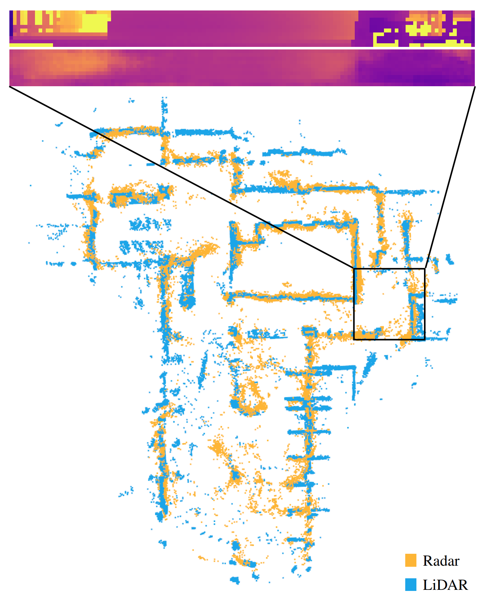

# RadarDepth

**From imaging radar to cylindrical depth maps and indoor geometry.**

Learn depth from ColoRadar measurements with LiDAR supervision. A learned visibility mask removes directions the radar cannot observe before the depth map is projected into geometry.

<a id="pipeline"></a>



*Orange denotes radar geometry; blue denotes LiDAR. This retained qualitative comparison is not a new evaluation run or an accuracy measurement.*

[Inspect without a dataset](#start-without-a-dataset) · [Prepare and run](#run-the-research-pipeline) · [Network source](networks/DepthRefinement/model.py) · [Research reference](docs/REFERENCE.md)

<a id="verification"></a>

## Start without a dataset

From the repository root, using Python 3:

```bash
python radardepth.py --help
python -m unittest discover -s tests -v
```

These commands use the standard library only. Help lists `train` and `evaluate`; the dispatch test checks arguments, working directories and child exit-code propagation without launching training or inference. This is a useful first check of the entry point, not a depth-estimation demo.

For the previously recorded random-weight CPU network comparison, see [verification](docs/VERIFICATION.md) and the separate [kernel requirements](requirements-kernels.txt). That comparison needs an explicit prior checkout and does not measure trained accuracy.

<a id="set-up"></a>

## Run the research pipeline

The full route needs **ColoRadar runs, the matching calibration and model weights**. Measurements and trained checkpoints are not bundled. Use a separate Python environment for the application dependencies:

```bash
python -m pip install -r requirements.txt matplotlib
```

The retained [dataset guide](docs/REFERENCE.md#dataset) explains the layouts, but its shell launcher currently only lists directories: the conversion commands inside it are commented out. Use the two Python conversion scripts explicitly. From `generate_dataset/`, for one run:

```bash
python raw_dataset_to_numpy.py -s PATH_TO_COLORADAR/RUN -c PATH_TO_COLORADAR/calib -o PATH_TO_TEMPORARY/run0
python numpy_to_trainset.py -l PATH_TO_TEMPORARY/run0/raw/lidar -r PATH_TO_TEMPORARY/run0/raw/radar -m ../calib/radarMapping.npz -c ../calib/calibration.npz -o PATH_TO_TRAINING_DATA/run0 -lower 8 -upper 24
```

Use absolute paths for the `PATH_TO_...` placeholders, and repeat with the appropriate output run names. Training currently selects `run2` and tests on `run0`, `run1` and `run4` in [`train.py`](train.py), so prepare those runs consistently. These are source-derived commands; dataset conversion has not been freshly executed. Return to the repository root for training and evaluation:

```bash
python radardepth.py train -d PATH_TO_TRAINING_DATA -o output -s true
python radardepth.py evaluate -m MODEL_PATH -c calib/radarMapping.npz -r calib/calibration.npz -d PATH_TO_TRAINING_DATA/run0 -l PATH_TO_TEMPORARY/run0/raw/lidar/
```

`-s true` enables the segmentation branch and is required by the retained training parser. `train` forwards to [`train.py`](train.py); `evaluate` forwards to [`eval.py`](eval.py). Evaluation opens a Rerun viewer comparing predicted radar geometry, LiDAR labels and raw LiDAR points. The full stack and trained-data route have not been freshly reproduced by this edition.

| To inspect | Open |
| --- | --- |
| Radar-volume network, depth regression and visibility branch | [`model.py`](networks/DepthRefinement/model.py) |
| Raw captures → NumPy → training layout | [Dataset preparation](docs/REFERENCE.md#dataset) |
| Dataset format and paired supervision | [`dataloader/dataset.py`](dataloader/dataset.py) |
| Calibration and geometry comparison | [`eval.py`](eval.py) |
| Passed checks and unavailable checks | [Verification record](docs/VERIFICATION.md) |

If help works but training fails on an import, help has only verified the dependency-free dispatcher. Install the full application requirements in the same environment. Missing data or checkpoint errors require the external artifacts above; the retained illustration is not a bundled model output to replay.

<a id="source"></a>

## License

The [project license](LICENSE) and [third-party notices](THIRD_PARTY_NOTICES.md) cover the research source and bundled ColoRadar tools. [Source provenance](NOTICE.md).
